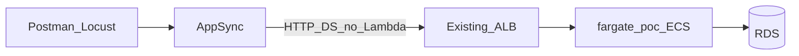

# PoC Plan: AppSync Direct HTTP Resolvers → Existing ALB/ECS (No Lambda)

## Research note

Exa (`web_search_exa`) used successfully for AppSync HTTP DS / data-source guidance. Follow-up Exa fetch hit rate limits; API details confirmed via AWS docs WebFetch.

There is **no** `web_search_help` tool on the Exa MCP server—available tools are `web_search_exa` and `web_fetch_exa`.

---

## 1. PoC Objectives

- Determine if **AppSync → HTTP resolver → existing ALB → existing ECS → RDS** is AWS-supported and workable for `listPatients`.
- Bypass Lambda unless research/runtime proves it is required.
- Reuse existing AppSync API, schema contract, fargate-poc ECS/ALB, and RDS path.
- Preserve GraphQL request/response contract; no frontend changes.
- Benchmark AppSync→Lambda vs AppSync→ALB→ECS (Postman + Locust).
- Produce a clear **Go / Conditional Go / No-Go**.

**Non-goals:** Other GraphQL fields; auth redesign; new ECS/ALB/CDK; FE tests.

---

## 2. Existing Architecture Analysis

| Layer | Today |
|---|---|
| Client | GraphQL → AppSync (Cognito/IAM) |
| Field | `listPatients` `@function(name: "Resolvers-${env}")` |
| Resolver | Shared VTL → Resolvers Lambda |
| Logic | [`patient.list_patients`](amplify/backend/function/Resolvers/src/patient.py) |
| Data | Django ORM → RDS Proxy → PostgreSQL |

Bottlenecks: Lambda cold starts; shared Resolvers function; DB-heavy annotations.

---

## 3. `@fargate-poc` Analysis & Reuse

**Stack:** Django + Strawberry on ECS Fargate; internet-facing ALB **HTTP `:8000`**; vendored ORM; `list_patients` ported from Resolvers.

| Path | Role |
|---|---|
| `POST /graphql/` | Strawberry `listPatients` (direct clients today) |
| `GET /health/` | ALB health |

Auth: none (synthetic SUPERUSER)—acceptable (testing uses `<POSTMAN_BEARER_TOKEN>` on AppSync only).

| Component | Disposition |
|---|---|
| ECS service, ALB, TG, ECR, IAM, `/health/` | **Reuse** |
| `list_patients` + `vendor/django_setup` | **Reuse** |
| Strawberry `/graphql/` | **Reuse** for A/B / fallback mapping |
| Thin `POST /api/list-patients/` | **New (minimal)** — preferred HTTP DS target |
| AppSync HTTP DS + field resolver | **New (AppSync config)** |
| ECS CDK / new ALB / API GW | **Do not create** |

DB placeholders: `<DATABASE_CONNECTION_URL>`, `<DATABASE_USERNAME>`, `<DATABASE_PASSWORD>`.

---

## 4. Research Findings (Exa + AWS Docs)

### Can AppSync directly invoke ECS via ALB?

**Yes, if the ALB endpoint is publicly reachable.** AppSync does not speak “ECS” natively; it calls an **HTTP endpoint**. An internet-facing ALB in front of ECS is a valid HTTP data source target.

Evidence:

- [HttpDataSourceConfig](https://docs.aws.amazon.com/appsync/latest/APIReference/API_HttpDataSourceConfig.html): endpoint may be **HTTP or HTTPS**, with optional **host:port**.
- [HTTP resolvers tutorial](https://docs.aws.amazon.com/appsync/latest/devguide/tutorial-http-resolvers.html): **“only public endpoints are supported.”**
- [Choosing data source](https://docs.aws.amazon.com/appsync/latest/devguide/choosing-data-source.html): prefer **direct** HTTP DS over Lambda when business logic lives behind an HTTP API; Lambda when you need network/filesystem/complex runtime beyond `APPSYNC_JS`.

Existing PoC ALB is **internet-facing HTTP `:8000`** → **Lambda is not required by AWS for this topology.** Lambda is the workaround only for **private** VPC endpoints ([re:Post](https://repost.aws/knowledge-center/appsync-access-private-resources-in-vpc)).

### Can HTTP data sources replace Lambda?

**Yes for this PoC.** HTTP DS + JS/VTL mapping replaces the `@function` Lambda invoke for `listPatients` only. Heavy ORM logic stays on ECS (already implemented)—AppSync only maps args ↔ HTTP ↔ GraphQL types.

### Is API Gateway required?

**No.** Tutorial uses API Gateway as an example REST front door, not a hard requirement. Direct public ALB is sufficient if AppSync can open the URL.

### Can the existing ALB be reused?

**Yes.** Point HTTP DS endpoint at `http://<existing-alb-dns>:8000` (scheme/port allowed by API). No duplicate ALB.

### Networking, IAM, timeout, payload, auth

| Topic | Finding | PoC implication |
|---|---|---|
| Networking | Public endpoint required | Validate AppSync → ALB:8000 from AWS network; SG must allow AppSync egress sources (public ALB typically `0.0.0.0/0` on listener) |
| Private ALB | Not supported for HTTP DS | Would force Lambda—**not** current PoC ALB |
| IAM | HTTP DS optional SigV4 for AWS APIs | ALB needs no SigV4; optional custom headers |
| HTTPS CAs | Apply to HTTPS endpoints | HTTP ALB avoids CA list; production should move to HTTPS later |
| Timeouts | AppSync resolver ~30s | Align ECS/DB SLAs; existing listPatients can be multi-second |
| Payload | HTTP body via resolver mapping | Prefer REST JSON over nested GraphQL |
| Auth | AppSync auth unchanged; Fargate unauthenticated | Test with Bearer `<POSTMAN_BEARER_TOKEN>`; production must lock ALB |

**Conclusive answer:** For the **existing public ALB**, AppSync **can bypass Lambda** via an HTTP data source. Lambda is **not** mandated unless Phase 0 shows the endpoint is unreachable/non-public.

---

## 5. GraphQL Schema Assessment

| Question | Answer |
|---|---|
| Is a schema mandatory? | **Yes** — AppSync is schema-first. |
| Can the existing schema be reused? | **Yes** — keep `listPatients` args/return types (`ModelPatientConnection`, filters, etc.). |
| Change only resolver/data source? | **Yes** — remove `@function` from **only** `listPatients`; attach HTTP DS resolver. Do not redesign types. |

Amplify note: field currently has `@function(name: "Resolvers-${env}")`. PoC removes that directive on this field and wires HTTP DS via Amplify [`CustomResources.json`](amplify/backend/api/GQL/stacks/CustomResources.json) (AppSync config—not ECS CDK). Other fields stay on Resolvers Lambda.

---

## 6. Recommended Target Architecture

```text
Client (Postman/Locust)
  → AppSync (existing API + schema)
    → HTTP Data Source (NEW config)
      → Existing ALB :8000
        → Existing fargate-poc ECS
          → RDS Proxy / PostgreSQL
```



| Piece | Type |
|---|---|
| AppSync API, Cognito auth modes, schema types | Reused |
| HTTP DS + `Query.listPatients` resolver mapping | New config |
| Remove `@function` on `listPatients` only | Schema directive change |
| ECS/ALB/RDS/fargate-poc logic | Reused |
| Optional `POST /api/list-patients/` | Minimal new app code |
| Lambda intermediary | **Not used** (fallback only if Phase 0 fails) |

**Fallback (only if required):** Lambda-in-VPC proxy per AWS re:Post—document as Conditional/No-Go on “direct” goal.

---

## 7. Phased Implementation Plan

### Phase 0 — Feasibility smoke (no cutover)
- Create temporary HTTP DS in AppSync console/CLI pointing at `http://<alb>:8000`.
- Resolver call `GET /health/` or `POST /graphql/`.
- **Exit:** Confirm public reachability. If fail → stop direct path; document Lambda-only alternative.

### Phase 1 — Fargate adapter (maximize reuse)
- Add `POST /api/list-patients/` wrapping existing `list_patients()` → Lambda-shaped JSON.
- Keep `/graphql/` for direct baselines.
- Redeploy **existing** ECS service image only.
- **Exit:** Curl ALB returns `{ total, items, aggregateItems }`.

### Phase 2 — AppSync HTTP resolver for `listPatients`
- Remove `@function` from `listPatients` only.
- Add HTTP DS endpoint = existing ALB base URL.
- JS or VTL: map `ctx.arguments` → POST `/api/list-patients/`; map 200 body → GraphQL result; non-200 → `$util.error`.
- Auth directives unchanged (`@aws_cognito_user_pools` / `@aws_iam`).
- **Exit:** Postman AppSync `listPatients` with Bearer `<POSTMAN_BEARER_TOKEN>` returns contract-compatible data; ECS logs show hits.

### Phase 3 — Benchmark
- See §9.
- **Exit:** Metrics table for both paths.

### Phase 4 — Decision
- Go/No-Go write-up; rollback = restore `@function` on the field.

---

## 8. `listPatients` Migration Steps

1. **Baseline** Postman against current AppSync→Lambda.
2. **Adapter** on fargate-poc (reuse service layer).
3. **HTTP DS** + resolver mapping (args → JSON body including optional identity stub; SUPERUSER OK for PoC).
4. **Detach** Lambda for this field only (`@function` removal).
5. **Validate** filters/limit/page/aggregates parity.
6. **Benchmark** vs Lambda path.
7. **Rollback** re-attach `@function` if needed.

Request mapping sketch (JS):

```js
export function request(ctx) {
  return {
    method: 'POST',
    resourcePath: '/api/list-patients/',
    params: {
      headers: { 'Content-Type': 'application/json' },
      body: JSON.stringify({
        arguments: ctx.args,
        identity: { claims: { role: 'SUPERUSER' }, groups: [] },
      }),
    },
  };
}
export function response(ctx) {
  if (ctx.error) util.error(ctx.error.message, ctx.error.type);
  if (ctx.result.statusCode !== 200) util.error(ctx.result.body, 'HttpError');
  return JSON.parse(ctx.result.body);
}
```

---

## 9. Performance Benchmarking (Postman / Locust)

| Path | Flow |
|---|---|
| A | AppSync → Lambda → RDS (current) |
| B | AppSync → HTTP DS → ALB → ECS → RDS (proposed) |
| C (optional) | Direct ALB `/graphql/` (isolate AppSync overhead) |

**Metrics:** avg, P50, P95, P99, throughput, error rate, cold starts (A only), ECS CPU/mem (B), AppSync overhead (B − C).

**Tools:** Postman (functional + single-shot); Locust (1/10/50 VUs, fixed query). Optional reuse fargate-poc k6 scripts.

---

## 10. Risks, Limitations, Success Criteria

**Risks / limits**
- Public-endpoint-only HTTP DS; private ALB would force Lambda.
- Unauthenticated ALB (PoC risk).
- Nested GraphQL if REST adapter skipped.
- AppSync ~30s timeout; large payloads; VTL/JS mapping complexity for nested filters.
- Amplify `@function` removal must not break other fields.
- HTTP cleartext to ALB—acceptable for PoC; HTTPS recommended for production.

**Success criteria**
- Direct AppSync→ALB→ECS works without Lambda.
- Schema/contract preserved; Postman Bearer works.
- Functional parity on fixtures.
- P95 of path B within ~+15% of warm Lambda **or** clear cold-start/ops win.
- Rollback &lt; 5 minutes.

---

## 11. Go / No-Go Framework

| Result | Criteria |
|---|---|
| **Go** | Phase 0 reachability OK; contract parity; performance acceptable; ops simpler than Lambda for this field |
| **Conditional Go** | Works but needs HTTPS on existing ALB, ALB auth, or mapping hardening before more fields |
| **No-Go (direct)** | AppSync cannot reach ALB / only private networking available → Lambda proxy required; “bypass Lambda” goal fails |

**Evidence pack:** Phase 0 smoke logs, Postman parity, Locust percentiles, Amplify diff (directive + CustomResources), explicit citation that HTTP DS supports public HTTP(S) ALB without API Gateway or Lambda.

---

## Conflict resolution (if blocked)

If HTTP DS cannot reach the current ALB (SG, non-public, or platform error):

1. Document failure with AWS “public endpoints only” guidance.
2. **Minimal** fix to stay direct: ensure ALB remains internet-facing and listener allows AppSync (reuse ALB—no new stack). Optional HTTPS listener on **same** ALB if HTTP scheme fails in practice.
3. Only if still impossible: Lambda-in-VPC proxy—and mark PoC **No-Go** for “direct ECS resolvers.”
