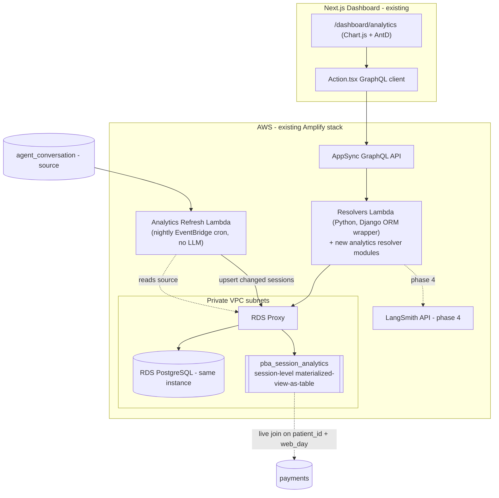

## Codebase Summary

- **DB**: One RDS PostgreSQL instance + RDS Proxy in private VPC subnets ([`amplify/backend/custom/rds/rds-cloudformation-template.json`](amplify/backend/custom/rds/rds-cloudformation-template.json)). `DBName == env`. App already reads `agent_conversation`, `payments`, `practices` from this DB.
- **Backend**: AppSync GraphQL -> single `Resolvers` Python 3.10 Lambda dispatch ([`amplify/backend/function/Resolvers/src/index.py`](amplify/backend/function/Resolvers/src/index.py)). Django ORM via layer [`patriotpayDjangoORM/opt/python/django_setup/models.py`](amplify/backend/function/patriotpayDjangoORM/opt/python/django_setup/models.py). Analytics precedent: `getScoreboard` ([`scoreboard.py`](amplify/backend/function/Resolvers/src/scoreboard.py)) + nightly `ScheduledScoreboardAggregator` cron writing pre-agg table `ScoreBoardDailyData`.
- **Frontend**: Next.js 14 App Router, `/dashboard/*`, Chart.js + Ant Design + SCSS, Amplify GraphQL via [`src/utility/Action.tsx`](src/utility/Action.tsx) + [`src/graphql/`](src/graphql), role-gated ([`src/libs/auth/roleConfig.ts`](src/libs/auth/roleConfig.ts)).
- **POC** ([`resources/llm/src/analytics/pba_analytics_poc`](resources/llm/src/analytics/pba_analytics_poc)): read-only FastAPI, ~17 chart endpoints (live reads of `agent_conversation`/`payments`) with hand-built D3 charts, plus a few LangSmith-sourced charts. The POC also ships an offline Bedrock session-summary classifier (clarity/intent cache tables) — **dropped for production** per updated scope (no LLM classification).

---

## 1. Analysis and Key Decisions (how I got here)

The dominant constraint is **scale: ~150 new sessions/day** (~4.5K/month, ~55K/year). That is trivially small for Postgres, and it collapses most of the "do we need a warehouse / matview / ETL" questions to *no*.

### 1a. Same database and RDS instance? — YES

- Source tables (`agent_conversation`, `payments`, `practices`) already live in this DB. Any analytics store must join to them; putting it elsewhere forces cross-DB movement for no benefit.
- There is already a precedent for an analytics summary table in the same DB (`ScoreBoardDailyData`), created and refreshed by a cron Lambda. We follow that precedent.
- 55K rows/year does not justify a second instance, a read replica, or logical separation. **Decision: same DB, same RDS instance, additive tables only.**

### 1b. Materialized view / extra data store — ONE session-level table (materialized-view-as-table)

Updated scope: **no LLM/session-summary classification** (clarity, intent-from-summary, escalation-reason). That removes the expensive-per-request work that previously justified cache tables. What remains is a decision about read latency, and here we deliberately add **one** denormalized, session-grained table that behaves like a materialized view.

- **All defined DB charts are session-grained** (funnel, rates, channel volume, SMS->Web, session volume, resolution rate, practice breakdowns, payments-correlation keys). Every one of them repeatedly re-derives the same things off the wide live `agent_conversation` table: the mutually-exclusive **funnel bucket** (a multi-branch `CASE` over `status` + `assigned_operator_id`) and **timezone-bucketed dates** (`created_at`, `resolved_at`, `sms_to_chat_at` → `::date` in `America/New_York`).
- Rather than repeat that `CASE`/`AT TIME ZONE` logic in ~10 resolvers against the live operational table, we precompute it **once per session** into `pba_session_analytics` (one row per `agent_conversation`). Every chart then becomes a trivial `GROUP BY` over a narrow, index-covered table — consistent, predictable latency and no scan contention with the live write path.
- This satisfies the stated constraints exactly: **session level only**, **only fields relevant to the existing defined charts**. LangSmith-sourced charts (web/SMS intent) keep **no store** — fetched live via SDK in Phase 4.

**Plain table, not a Postgres `MATERIALIZED VIEW`.** A true matview needs `REFRESH [CONCURRENTLY]` orchestration, a unique index for concurrent refresh, and DDL that Django migrations model awkwardly. A plain table upserted by an idempotent job is the house pattern (`ScoreBoardDailyData`) and lets us do **incremental** refresh (only changed sessions) instead of full recompute. We keep calling it a "materialized view" conceptually, but implement it as a maintained table.

`pba_session_analytics` columns (relevant-only): `conversation_id` (PK, FK→`agent_conversation`), `session_id`, `practice_id`, `patient_id`, `channel`, `status`, `assigned_operator_id`, `funnel_bucket` (enum: `ai_only_resolved` | `escalated_resolved` | `escalated_pending` | `returned` | `draft` | `other`), `created_at`, `resolved_at`, `closed_at`, `sms_to_chat_at`, `last_message_at`, and the tz-bucketed `created_day` / `resolved_day` / `web_day` (the payments-correlation day: `sms_to_chat_at::date` for `SMS_TO_CHAT` else `created_at::date`), plus `source_updated_at` for incremental sync. Payments stay live-joined (not session-grained) on `patient_id` + `web_day`.

### 1c. Where does aggregation / refresh happen, and query optimization?

- **Chart aggregations**: inside the `Resolvers` Lambda resolver modules (ported from POC `app/queries/*`) through a **thin Django ORM query wrapper**, reading `pba_session_analytics` with `aggregate()` / conditional `Count(..., filter=Q(...))` single-pass queries (mirrors `scoreboard.py`, no N+1 per backend rule #3). Payments-correlation additionally live-joins `payments`.
- **Table maintenance (the ETL)**: a **nightly EventBridge-scheduled Lambda** (clone of `ScheduledScoreboardAggregator`, **no Bedrock**) that transforms and upserts only sessions changed since the last run into `pba_session_analytics`. Initial population is a one-time backfill migration/script over existing `agent_conversation` rows.
- **Query optimization / indexes** on `pba_session_analytics`:
  - `(created_day, practice_id, channel, funnel_bucket)` — funnel/rates/volume by day+practice+channel.
  - `(practice_id, funnel_bucket)` — practice breakdowns.
  - partial `(web_day, practice_id) WHERE channel IN ('CHAT_WINDOW','SMS_TO_CHAT')` — payments correlation.
  - `payments (patient_id, payment_status, external_transaction_at)` — the live payment side of the correlation join.
  - At ~55K rows these keep every chart in single-digit-ms DB time (see latency section).

### 1d. Redshift / QuickSight / dedicated warehouse? — NO

- **Redshift**: columnar MPP for TB-scale scans. Our dataset is ~55K rows/year. It would add a cluster cost, VPC/network config, and a data-copy ETL for zero performance gain. Rejected.
- **QuickSight**: a BI/visualization product. We are building a bespoke Next.js + Chart.js dashboard with role-based auth already; QuickSight would duplicate the presentation layer, add per-user licensing, and fight our existing auth. Rejected.
- **Decision: no warehouse, no BI tool. Existing RDS Postgres is the analytics store.**

### 1e. Backend + charting (confirmed with user)

- Port POC read queries into the existing `Resolvers` Lambda as new GraphQL queries (no new infra, matches `getScoreboard`). The FastAPI app is **not** deployed.
- Rebuild charts in **Chart.js** (+ Ant Design + SCSS) to match the existing dashboard; D3 is dropped.

---

## 2. Target Architecture (over existing)

Only **additive** components: one new session-level table, one backfill migration, one nightly refresh Lambda, new resolver modules, new GraphQL queries, one new FE route. Nothing existing is modified beyond append-only edits to `schema.graphql`, `index.py`, sidebar/role config. `agent_conversation`/`payments` remain read-only sources.

---

## 3. ETL Strategy (maintain `pba_session_analytics` — the only ETL, no LLM)

This is a pure SQL/ORM transform — **no Bedrock, no LLM**. Two parts: a one-time backfill and an incremental nightly refresh.

**Part A — Backfill (one-time, ships with Phase 0)**
- A Django **data migration** (or a standalone idempotent script invoked once) reads all existing `agent_conversation` rows and upserts one `pba_session_analytics` row each, computing `funnel_bucket` and the tz date buckets.
- **Batched** (e.g. 5K rows/iteration via `.iterator()`) to bound memory (backend rule #10); **idempotent** (`ON CONFLICT (conversation_id) DO UPDATE`); **dry-run by default** with `--apply` to write (backend rule #7); logs `found / upserted / skipped`.
- At current volume (~55K/year historical) this is seconds of work.

**Part B — Incremental nightly refresh (Phase 0 job)**
- **Trigger**: EventBridge `cron` nightly (e.g. `cron(30 1 * * ? *)`), after the day's sessions settle. New standalone Lambda cloned from `ScheduledScoreboardAggregator` (Python, Django ORM layer, VPC/RDS Proxy) — **minus the Bedrock/aggregation logic**.
- **Extract**: sessions where `agent_conversation.updated_at`/`last_message_at` > `pba_session_analytics.source_updated_at` (or missing) — only changed/new rows. At ~150 new sessions/day plus a few status changes, each run touches well under a few hundred rows.
- **Transform**: derive `funnel_bucket` (the §1 `CASE` on `status` + `assigned_operator_id`) and tz date buckets in Python/SQL. No external calls.
- **Load**: `INSERT ... ON CONFLICT (conversation_id) DO UPDATE` upsert. Idempotent, re-runnable (backend rules #5, #7).
- **Guardrails**: dry-run default flag, structured logging of `found / upserted / skipped`, no PII in logs (do not log `latest_ai_summary` or names).

**Staleness trade-off:** nightly refresh means the dashboard is as of last night (up to ~24h lag). Acceptable for trend/reporting metrics. If near-real-time is later required, upgrade to (a) updating the row inline in the existing `agent_conversation` write path on status change, or (b) a lightweight more-frequent cron (e.g. hourly) — both use the same idempotent upsert.

**Reopen caveat preserved:** `resolved_at` is cleared on `REOPENED_IN_PROGRESS`; the refresh recomputes the bucket, so a reopened session correctly flips to `returned`. Historical resolution trends stay lossy (surfaced as a caveat banner), unchanged from the POC.

LangSmith charts (Phase 4) do **no** ETL — resolver calls the LangSmith SDK live at request time with short-TTL in-memory caching (rate limit ~3 req/10s), no persisted store.

---

## 4. Trade-offs Considered

- **Session-level table (materialized-view-as-table) vs live aggregation on `agent_conversation`**: chose the maintained table. Trade-off: a backfill + nightly refresh job to own, and up to ~24h staleness. Justified: precomputing `funnel_bucket` + tz date buckets once keeps every chart a trivial `GROUP BY` over a narrow index-covered table, gives predictable low latency, and isolates analytics scans from the live operational write path. (Given tiny volume, live aggregation would also perform fine — the table is chosen primarily for query simplicity, consistency of the bucket definition in one place, and read/write isolation.)
- **Plain table vs Postgres `MATERIALIZED VIEW`**: chose plain table. Trade-off: we own the upsert logic. Justified: no `REFRESH CONCURRENTLY` orchestration, supports **incremental** refresh (changed rows only), and fits the existing Django-migration + cron-Lambda house pattern.
- **Nightly refresh vs event-driven upsert**: chose nightly cron. Trade-off: ~24h lag. Justified: simplest, cheapest, and metrics are trend/reporting-oriented. Escape hatch: inline upsert in the `agent_conversation` write path, or hourly cron, both reuse the same idempotent upsert.
- **Port to GraphQL vs lift-and-shift FastAPI**: chose port. Trade-off: rewrite effort porting ~17 endpoints. Justified: reuses `Resolvers` infra, auth, VPC, RDS Proxy, Sentry, and RBAC for free; avoids a second web runtime + parallel auth. Lift-and-shift would violate "follow existing standards."
- **Chart.js vs D3**: chose Chart.js. Trade-off: bespoke D3 visuals (hand-built stacked/dual-axis) must be re-expressed and Chart.js is less flexible. Justified: matches scoreboard + existing PDF-export tooling and team convention.
- **No LLM classification (updated scope)**: drops summary-clarity (§4) and escalation-reason (§5) charts, which required a Bedrock pass over `latest_ai_summary`. Trade-off: two qualitative insights are deferred. Justified: removes all Bedrock cost, latency, rate-limit, and PII-handling concerns from the pipeline.
- **No warehouse**: trade-off is no heavy ad-hoc OLAP. Justified at this scale; revisit only if data/query complexity explodes.

---

## 4b. Latency Analysis (per API call)

Every chart is its own GraphQL query; the FE fires them in parallel (`Promise.all`, as the POC does). Latency budget per call has three parts: **network + AppSync**, **Lambda invocation (cold vs warm)**, and **DB query**.

| Source class | Charts | DB query time | Dominant latency factor | Mitigation |
|---|---|---|---|---|
| `pba_session_analytics` (indexed, ~55K rows) | funnel, rates, channels, session-volume, resolution-rate, practice breakdown | single-digit ms | Lambda **cold start in VPC** (~1–3s first hit), not the query | shared warm `Resolvers` Lambda; batch related charts into fewer queries |
| Session table + live `payments` join | payments-correlation | low tens of ms | same cold start | index on `payments (patient_id, payment_status, external_transaction_at)` |
| Proxy timing (PBATimeline) | time-to-escalation/resolution | tens of ms | cold start + timeline scan | index on timeline event type/date |
| **LangSmith API (Phase 4)** | web/SMS intent time-series | **100s of ms to seconds** | external network + **rate limit ~3 req/10s** | request-time short-TTL cache; render async with loading state; never block DB charts |

Key latency trade-offs and decisions:

- **Fan-out vs fat query**: the POC fires ~17 independent GETs. On Lambda this means up to ~17 concurrent invocations of `Resolvers` → more cold starts and connection churn. **Decision: group charts that share the same filters/query base into a single GraphQL query** returning a composite payload (e.g. one `pbaFunnelAndRates` call), cutting round-trips and Lambda invocations. Keeps p95 down without provisioned concurrency.
- **VPC cold start is the real cost, not SQL.** At this data volume SQL is negligible; perceived latency is Lambda cold start on first load. Accept it (lazy) for an internal analytics page; if it becomes a complaint, the cheap fix is a small provisioned-concurrency setting on `Resolvers` or a warmer ping — not a data-layer change.
- **RDS Proxy** already pools connections, so per-invocation connection setup is cheap and we won't exhaust Postgres connections under parallel fan-out.
- **LangSmith isolation**: LangSmith-backed charts are the only ones that can be slow/flaky. They must load independently and degrade to an `unavailable` state so they never delay the DB-sourced charts.

---

## 5. Implementation Challenges

- **Single source of truth for `funnel_bucket`**: the bucket `CASE` logic now lives in the backfill migration, the nightly refresh job, **and** must not be re-derived divergently in resolvers. Mitigation: put the derivation in one shared helper in the `patriotpayDjangoORM` layer, imported by both the refresh job and (if ever needed) resolvers. Cover with a parity test.
- **Keeping the table in sync with `agent_conversation`**: a session whose status changes after its nightly upsert is stale until the next run (e.g. same-day reopen). Mitigation: refresh keys off `updated_at`/`last_message_at`; document the ~24h lag; escape hatch to inline/hourly upsert if needed.
- **SQL portability**: POC uses raw psycopg SQL; production uses Django ORM / `django.db.connection` via the wrapper. Payments-correlation CTE (distinct web session keys before join) must port with identical semantics — cover with parity tests against the POC's `expected_shapes.json`.
- **RBAC**: POC has no auth; production must apply practice-scoping (`_get_user_allowed_practice_ids` / `apply_role_based_access_control_*`) to every analytics query so clinic roles only see their practices. `pba_session_analytics.practice_id` makes this a simple `WHERE practice_id IN (...)`. Net-new per endpoint.
- **Migrations on a shared prod DB**: the new table + indexes go through the ORM layer `migrations/`; create indexes on the source `payments` table with `CREATE INDEX CONCURRENTLY` (via `migrations.RunSQL` + `atomic = False`) to avoid locking. The backfill data migration must be batched and safe to re-run.
- **Schema drift**: `escalated_at` still doesn't exist; time-to-escalation/resolution remain proxy metrics (LangSmith end-time / `PBATimeline`). Escalation-**reason** breakdown is dropped (needed LLM). Ship proxies with explicit caveat banners.
- **LangSmith rate limits** (Phase 4): live pulls are throttled; needs request-time caching and graceful `unavailable` states; must not block DB charts.
- **GraphQL schema size**: `schema.graphql` is ~3,300 lines; additions must follow existing `ModelXConnection` conventions and `@function(name:"Resolvers-${env}")` wiring to stay codegen-compatible (`src/API.ts`).
- **VPC cold starts**: analytics resolvers inherit the existing VPC Lambda cold-start profile — the dominant latency (see §4b), not the SQL.

---

## 6. Phased Delivery (no production feature impact — all additive)

Each phase is independently shippable and touches only new code paths.

### Phase 0 — Data foundation (DB + ETL, invisible to users)
- **Migration**: create `pba_session_analytics` model + migration (fields per §1b) with the indexes in §1c; add the `payments` index via `RunSQL ... CONCURRENTLY`.
- **Backfill**: batched, idempotent, dry-run-default data migration/script porting existing `agent_conversation` sessions into the table.
- **Refresh job**: new nightly `PbaAnalyticsRefresh` Lambda (clone `ScheduledScoreboardAggregator`, no Bedrock) doing incremental upserts; shared `funnel_bucket` helper in the ORM layer.
- Verify on stage: backfill counts match `agent_conversation`, buckets sum correctly, refresh is idempotent.

### Phase 1 — DB-sourced charts end-to-end (feature-flagged)
- Thin Django ORM query wrapper + port funnel, rates, channel metrics, session-volume, resolution-rate, practice breakdown, payments-correlation queries into new `Resolvers/src/pba_analytics_*.py` modules reading `pba_session_analytics` (+ live `payments` join); register in `index.py` with RBAC.
- Add GraphQL placeholder types/queries in `schema.graphql`; add `Action.tsx` helpers + `src/graphql` docs; batch co-filtered charts into composite queries (§4b).
- New `/dashboard/analytics` route: convert D3 charts to **Chart.js** shared chart components (design-system tokens → SCSS/AntD), behind a role/flag; add to `Routes.ts`, sidebar, `roleConfig.ts`.

### Phase 3 — Escalation insights (proxy-based)
- Time-to-escalation / time-to-resolution proxy charts (PBATimeline `PBA_CHAT_ESCALATED` / LangSmith end-time) with caveat banners. Escalation-**reason** breakdown is **out of scope** (needed LLM).

### Phase 4 — LangSmith-sourced charts (live, no store)
- Web/SMS intent time-series resolvers calling LangSmith SDK live with request-time caching and `unavailable` fallback; loaded independently of DB charts (§4b).

### Phase 5 — Hardening
- Full RBAC review, empty/loading/error states, caveat strip, PDF export (reuse existing tooling), remove feature flag / open to intended roles.

---

## 7. Rough Effort Estimates

Ranges in **developer-days** (one mid/senior engineer), excluding review/QA cycles. Assumes ~17 POC charts and familiarity with the existing patterns.

### 7.1 D3 → Chart.js conversion + design system
| Item | Estimate |
|---|---|
| Shared Chart.js chart components (stacked bar, line, bar, dual-axis line, KPI card, pie/donut) + resize/tooltip/empty-state helpers | 2.0 – 3.0 d |
| Design-system entities: map POC `tokens.css` (fonts, mint/sand/ink palette) to SCSS variables + AntD theme, chart color scales | 1.0 – 1.5 d |
| Port ~17 charts onto the shared components + filter bar + caveat strip + loading/error states | 3.0 – 4.5 d |
| **Subtotal** | **~6 – 9 d** |

### 7.2 GraphQL placeholder queries + Django ORM wrapper + resolver Lambda
| Item | Estimate |
|---|---|
| GraphQL schema: ~17 (or fewer, if batched) query + `Model*Connection`/type definitions with `@function(name:"Resolvers-${env}")`, plus `Action.tsx` + `src/graphql` docs | 1.5 – 2.5 d |
| Thin Django ORM query wrapper (filters, tz, RBAC scoping, single-pass aggregates) | 1.0 – 1.5 d |
| Port POC query logic into `Resolvers/src/pba_analytics_*.py` modules + register in `index.py` (incl. payments-correlation CTE) | 3.0 – 4.5 d |
| Parity tests vs `expected_shapes.json` + RBAC tests | 1.0 – 1.5 d |
| **Subtotal** | **~6.5 – 10 d** |

### 7.3 New table migration + backfill of existing sessions (the "materialized view")
| Item | Estimate |
|---|---|
| `pba_session_analytics` model + migration + indexes (incl. `CONCURRENTLY` payments index) | 0.5 – 1.0 d |
| Shared `funnel_bucket` derivation helper (+ unit test) | 0.5 d |
| Batched idempotent backfill data-migration/script (dry-run default) + stage validation | 1.0 – 1.5 d |
| Nightly `PbaAnalyticsRefresh` Lambda (clone `ScheduledScoreboardAggregator`, cron wiring, `backend-config.json`, CFN, layers/VPC) | 1.0 – 2.0 d |
| **Subtotal** | **~3 – 5 d** |

**Rough total (7.1–7.3, core Phases 0–1): ~15.5 – 24 developer-days.** Phase 3 (proxy escalation, ~2–3 d), Phase 4 (LangSmith live, ~2–4 d), and Phase 5 hardening (~2–3 d) are additional. These are planning-level estimates; refine after the Phase 0 spike.

---

## Validation Checklist
- [ ] `pba_session_analytics` migration applies on stage; `payments` index built `CONCURRENTLY` with no lock on live tables
- [ ] Backfill is idempotent + batched; row count and bucket sums reconcile against `agent_conversation`
- [ ] Nightly refresh upserts only changed sessions; re-running is a no-op
- [ ] `funnel_bucket` derived from one shared helper (backfill = refresh = resolvers)
- [ ] Every ported query has parity with POC output shapes (`expected_shapes.json`)
- [ ] Every analytics resolver enforces practice-level RBAC
- [ ] Co-filtered charts batched to reduce Lambda fan-out (§4b); LangSmith charts load independently
- [ ] Charts are Chart.js; caveats shown for snapshot status, reopen-cleared `resolved_at`, escalation proxy, payments join ambiguity
- [ ] No LLM/Bedrock in the pipeline; no new DB instance, no Redshift/QuickSight, no Postgres matview
- [ ] Feature flag gates the route until Phase 5
