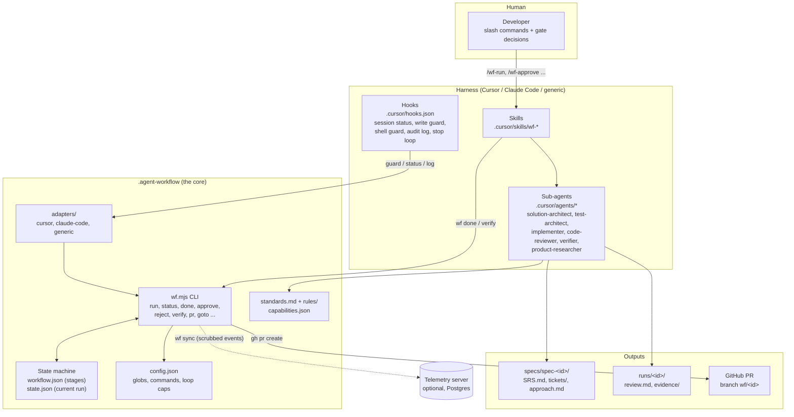
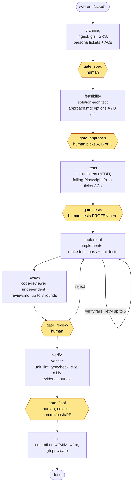
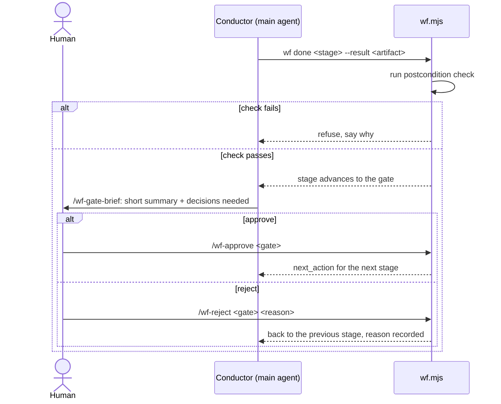

# User guide: the spec-driven agentic workflow

Written for: developers who will drive a feature or bug fix through this repo's pipeline in Cursor (or Claude Code).

## 1. What it is

A **gated build pipeline for AI coding agents**. You give it a ticket; agents write the spec, design, tests, code, review and PR, but **a human must approve six checkpoints ("gates")** and a **deterministic state machine** (`wf.mjs`) refuses to let anyone skip a step.

The repo is **not an application**. It is the workflow itself, installed into (or opened alongside) the project you want to build in.

Three ideas to hold on to:

1. **Spec first, tests before code.** Product tests are written from the spec and frozen before any implementation exists.
2. **The state machine is the boss, not the model.** Agents call `wf` commands; they never edit `state.json`. Each stage has a postcondition (a function, not model memory) that must pass before `wf done` advances.
3. **Hooks enforce it.** Edits outside the current stage's allowed paths, and `git commit` / `git push` / `gh pr create` before the final gate, are blocked.

## 2. High-level architecture



| Layer | Where | Job |
| --- | --- | --- |
| Skills | `.cursor/skills/wf-*` | One per stage. Tell the model what to read, what to produce, which `wf` command to finish with. Slash-only. |
| Sub-agents | `.cursor/agents/` | Specialised workers. Read-only ones (researcher, architect, reviewer) return text; the conductor writes the artifact. |
| Hooks | `.cursor/hooks.json` | Print status at session start, block disallowed edits and shell commands, log edits, drive the implement retry loop. |
| Core | `.agent-workflow/` | Stage definitions, state, postcondition checks, freeze hashes, PR delivery. |
| Adapters | `.agent-workflow/adapters/` | Translate each harness's hook format to the core. |
| Telemetry | `server/` (optional) | Receives scrubbed events (ids, counts, durations); no ticket text, code or prompts. |

## 3. The pipeline



Yellow hexagons are **human gates**. `implement` is the only stage with no gate on exit: it loops on its own (retry cap and stuck-loop detection) and hands straight to `review`.

### Who writes what

| Stage | Executor | May write | Artifact / result |
| --- | --- | --- | --- |
| `planning` | main agent + read-only sub-agents | `specs/**` | `SRS.md`, `grill/questions.json`, persona `tickets/` with AC test cases |
| `feasibility` | solution-architect | `specs/**` | `approach.md` |
| `tests` | test-architect | `product_test_globs` | failing product tests from ticket `PRD-n.m`, titled `PRD-1.1 REQ-1 ...` |
| `implement` | implementer | `src_globs`, `unit_test_globs`, **not** product tests | working code |
| `review` | code-reviewer (fixes by implementer) | same as implement | `runs/<id>/review.md` |
| `verify` | verifier | nothing | `runs/<id>/evidence/` |
| `pr` | main agent | nothing | GitHub PR |

### Gate flow



The conductor **never** approves or rejects a gate itself.

## 4. One-time setup

Prerequisites: Cursor with project skills + subagents enabled (or Claude Code), Node.js 20.12+, Git, `gh` logged in with a GitHub `origin` remote, `uv` (for BMAD skills).

```bash
# 1. (When installing into another project)
node installer/install.mjs --target /path/to/project --harness cursor   # or claude-code | generic

# 2. Detect the stack and fill blank test/lint commands in config.json
node .agent-workflow/wf.mjs init

# 3. In Agent chat: writes project-context.md and drafts rule packs
/wf-onboard

# 4. Read each drafted pack, then approve it
node .agent-workflow/wf.mjs init --approve-pack <stack>

# 5. Confirm nothing is left
node .agent-workflow/wf.mjs init --check
node .agent-workflow/wf.mjs doctor
```

Then edit `.agent-workflow/config.json`. The important fields:

| Field | Meaning |
| --- | --- |
| `product_test_globs` | Where flow tests live (default `E2E/tests/**`). Frozen at `gate_tests`. |
| `unit_test_globs` | Unit tests; owned by the implementer. |
| `src_globs` | Source the implementer may edit (default `src/**`; **change this to match your project**). |
| `commands.*` | `unit`, `lint`, `typecheck`, `format`, `complexity`, `seed`, `e2e`, `a11y`. Blank = not run. `e2e` should be `npx playwright test --reporter=list,json`. |
| `loop_caps` | `implement` 5, `review` 3, `verify_fix` 2. |
| `telemetry` | `enabled`, `server_url`, `required`. Leave `server_url` empty to stay local. |

## 5. Running it: a worked example

Ticket: *"PAT-1234: show an inline error when the email field on the signup form is invalid."*

**1. Start.** In Agent chat:

```text
/wf-run PAT-1234
```

Creates the run and the branch `wf/<run-id>` from your current branch, then drops into `planning`.

**2. Planning.** `/wf-start` runs ingest → grill/synthesize (Confluence + repo for auto-answers; you answer the rest) → `SRS.md` → persona tickets → acceptance test cases on each AC. Run `node .agent-workflow/wf.mjs tickets check`, then `/wf-spec-review`, then:

```bash
node .agent-workflow/wf.mjs done planning --result specs/spec-<id>/SRS.md
```

**3. Gate: spec.** Brief (`/wf-gate-brief`), read `SRS.md` and `tickets/`, then `/wf-approve gate_spec`. Optional: `/wf-jira-tickets` if you want Jira issues created.

**4. Feasibility.** `solution-architect` proposes approaches A/B/C with blast radius. At the gate you pick one:

```text
/wf-approve gate_approach --approach B
```

**5. Tests.** `test-architect` writes failing Playwright tests from ticket `test_cases`; you approve `gate_tests`. **From here the product tests are frozen**: the implementer cannot edit, skip or delete them.

**6. Implement.** The implementer makes the tests pass and writes unit tests. It must run `node .agent-workflow/wf.mjs verify` and trust its exit code. If verify fails, the stop hook re-runs the stage, up to 5 times.

**7. Review.** An independent `code-reviewer` writes `runs/<id>/review.md`. Findings are fixed one by one; a finding is closed only when its line contains `[resolved]`. Approve `gate_review`, or reject to send the run back to `implement`:

```text
/wf-reject gate_review "error also needs aria-live for screen readers"
```

**8. Verify.** The `verifier` runs unit, lint, typecheck, format, complexity, seed, e2e and a11y, does an exploratory browser pass, and writes the evidence bundle. Every automated `PRD-n.m` scenario from persona tickets needs a passing Playwright test. Flaky-on-retry tests are listed but don't block.

**9. Final gate and PR.** Approve `gate_final` (this unlocks commit/push/PR), then `/wf-pr`: the agent commits on `wf/<run-id>`, writes a plain-language change summary, and `wf pr` pushes and runs `gh pr create` back to the branch you started from. If `wf adr` has been run, the ADR file must be committed first.

Check where you are at any time:

```bash
node .agent-workflow/wf.mjs status
```

## 6. Command cheat sheet

**Slash skills (in Agent chat)**

| Command | Who | Purpose |
| --- | --- | --- |
| `/wf-run <ticket>` | human | Start a run (one at a time). |
| `/wf-approve <gate>` | human | Pass a gate. |
| `/wf-reject <gate> <reason>` | human | Send back to the stage before the gate. |
| `/wf-gate-brief` | human | Short brief for the current gate. |
| `/wf-unblock` | human | Explain options after a loop-cap or stuck-loop stop. |
| `/wf-pause`, `/wf-resume`, `/wf-abort` | human | Archive, restore or stop a run. |
| `/wf-onboard` | human | Project context and rule packs after `wf init`. |
| `/wf-goto` | human | Jump stages (see below). |
| Stage skills `/wf-start`, `-research`, `-spec-review`, `-feasibility`, `-tests`, `-implement`, `-review`, `-verify`, `-pr` | conductor | Invoked by the pipeline; you rarely type them. |

**CLI (`node .agent-workflow/wf.mjs ...`)**

| Command | Purpose |
| --- | --- |
| `status` | Current stage and `next_action`. |
| `done <stage> --result <path>` | Advance after the postcondition passes. |
| `verify` | Run all configured checks; exit code is the truth. |
| `brief [gate]` | Facts for the gate you're at. |
| `goto <stage>` | Backwards always works; forwards only over stages whose artifact passes and never over an unapproved gate. |
| `escalation list\|retry\|reject\|abort` | Get out of a loop-cap/stuck stop. |
| `adr` | Copy the run's decision record to `docs/adr/NNNN-<slug>.md`. |
| `doctor` | Check capabilities, skills, agents, standards agree. |
| `login`, `sync`, `whoami`, `logout`, `report-failure` | Telemetry. |

## 7. What to take care of

**Do**

- Run `wf status` first, always. Follow `next_action` exactly.
- Read the artifact at each gate. A gate is the only real review of the spec, the approach and the tests; the agents will not catch a wrong requirement.
- Fix `src_globs`, `unit_test_globs` and `commands` in `config.json` for your project before the first run, or the implementer/verify stages will be pointed at the wrong places.
- Commit `specs/spec-<id>/` with the change.
- Run `wf doctor` after editing skills, agents, `standards.md` or `capabilities.json`.
- Approve rule packs only after reading them; editing a pack afterwards returns it to draft.

**Don't**

- Edit `.agent-workflow/state.json`, `workflow.json` or `project.json` (protected; the guard blocks it).
- Run `git commit`, `git push` or `gh pr create` before `gate_final` is approved (blocked by hooks).
- Edit product tests after `gate_tests` (frozen by hash). To change them, `goto`/reject back to `tests`.
- Work on the workflow's own files while a run is active; the write guard will block you.
- Put PHI/PII or secrets in tickets, fixtures, logs or briefs. Telemetry scrubs and keeps only category and count, but don't rely on it.
- Start a second run while one is active, or ask an agent to approve a gate.

**Limits and recovery**

| Situation | What happens | You do |
| --- | --- | --- |
| `implement` fails 5 times, or loop looks stuck | Escalates; `status --check` fails | `/wf-unblock`, then `wf escalation retry\|reject\|abort` |
| `review` hits 3 rounds | Escalates | Same |
| `verify` fix rounds hit 2 | Escalates | Same |
| `wf done` refuses | Postcondition failed (e.g. open `[OPEN QUESTION]`, unresolved review finding, missing artifact) | Fix what it names, re-run |
| A sub-agent crashed or timed out | Conductor must record it | `wf report-failure <test_failure\|agent_crash\|timeout\|tool_error> <agent>` |
| Need to step back | | `wf goto <earlier-stage>` (human only) |
| Pause work mid-run | | `/wf-pause`, later `/wf-resume` |

**Harness notes**

- Cursor and Claude Code have full hook enforcement. The `generic` harness has none: it installs git hooks (`wf gate-check`) and a CI check (`wf ci-check`), and runs are recorded as `session_unchecked`.
- Not every change needs a run. A typo or one-line fix you will review yourself can just be edited directly (when no run is active).
- Telemetry is optional. With `telemetry.required: true` you must `wf login` first (the cached token works offline). Server setup is in `docs/RUNBOOK.md`.

## 8. Where things live

| Path | What |
| --- | --- |
| `specs/spec-<id>/` | `SRS.md`, `tickets/`, `approach.md` (commit these) |
| `.agent-workflow/runs/<id>/` | `review.md`, `deferred.md`, `evidence/` |
| `.agent-workflow/state.json` | Current run (never hand-edit) |
| `.agent-workflow/events.jsonl` | Local audit log |
| `.agent-workflow/rules/` | Stack rule packs |
| `docs/REQUIREMENTS.md`, `IMPLEMENTATION_PLAN.md`, `KNOWN_ISSUES.md`, `RUNBOOK.md`, `adapter-contract.md` | Deeper reference |
| `docs/PHASE1_MANUAL_TEST.md`, `PHASE2_MANUAL_TEST.md` | Manual walkthroughs to try it yourself |

Run the workflow's own tests with `npm test`.
